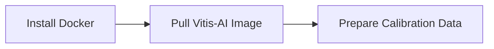
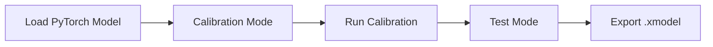

# YOLOv8n to Xilinx DPU (.xmodel) Conversion Guide

Complete guide for converting YOLOv8n object detection model from PyTorch to Xilinx DPU-ready `.xmodel` format using Vitis-AI.

---

## Table of Contents
1. [Overview](#overview)
2. [Prerequisites](#prerequisites)
3. [Conversion Workflow](#conversion-workflow)
4. [Step-by-Step Instructions](#step-by-step-instructions)
5. [Output Files](#output-files)
6. [Troubleshooting](#troubleshooting)
7. [Deployment](#deployment)

---

## Overview

This guide documents the conversion of **YOLOv8n** (PyTorch) to **INT8 quantized .xmodel** for Xilinx Zynq-7000 FPGA deployment.

### Conversion Pipeline

```
YOLOv8n (PyTorch .pt)
    ↓
ONNX (.onnx) [Optional Export]
    ↓
Vitis-AI Quantization (INT8)
    ↓
DPU-ready (.xmodel)
```

### Model Information

| Property | Value |
|----------|-------|
| **Model Name** | YOLOv8n |
| **Framework** | PyTorch (Ultralytics) |
| **Task** | Object Detection |
| **Classes** | 80 (COCO dataset) |
| **Input Size** | 640×640 RGB |
| **Parameters** | 3.16M |
| **Original Size** | 6.2 MB (.pt) |
| **Quantized Size** | 13.25 MB (.xmodel) |

---

## Prerequisites

### 1. Hardware Requirements

| Component | Requirement |
|-----------|-------------|
| **OS** | Windows 10/11 with WSL2 or Linux |
| **RAM** | 16 GB minimum |
| **Disk Space** | 20 GB free (for Docker + datasets) |
| **Internet** | Required for Docker image download |

### 2. Software Requirements

| Software | Version | Purpose |
|----------|---------|---------|
| **Docker Desktop** | Latest | Container runtime |
| **Vitis-AI Docker** | 3.5.0 | Quantization toolkit |
| **Python** | 3.8+ (host) | Data preparation |
| **PyTorch** | 2.x (host) | Model training/validation |

### 3. Required Files

Before starting, ensure you have:

| File | Size | Description |
|------|------|-------------|
| `yolov8n.pt` | 6.2 MB | Trained PyTorch model |
| `calibration_data/*.jpg` | ~200 images | COCO validation images |
| `simple_pytorch_quant.sh` | Script | Quantization automation |

---

## Conversion Workflow

### Phase 1: Environment Setup



### Phase 2: Quantization



---

## Step-by-Step Instructions

### Step 1: Install Docker Desktop

**Windows:**
1. Download from: https://www.docker.com/products/docker-desktop/
2. Install and restart PC
3. Launch Docker Desktop
4. Wait for "Docker is running" status

**Verification:**
```powershell
docker --version
```

**Expected Output:**
```
Docker version 29.2.1, build a5c7197
```

---

### Step 2: Pull Vitis-AI Docker Image

**Command:**
```powershell
docker pull xilinx/vitis-ai-pytorch-cpu:latest
```

**Details:**

| Property | Value |
|----------|-------|
| **Image Size** | ~16 GB (on disk) |
| **Download Size** | ~3.6 GB (compressed) |
| **Time Required** | 30-60 minutes (depends on internet) |
| **Version** | ubuntu2004-3.5.0.306 |

**Verification:**
```powershell
docker images xilinx/vitis-ai-pytorch-cpu
```

---

### Step 3: Prepare Calibration Dataset

Calibration images are needed for INT8 quantization.

**Source:** COCO 2017 Validation Dataset

**Requirements:**

| Parameter | Value |
|-----------|-------|
| **Number of Images** | 100-200 recommended |
| **Format** | JPEG (.jpg) |
| **Size** | Variable (will be resized to 640×640) |
| **Content** | Representative of deployment scenarios |

**Directory Structure:**
```
calibration_data/
├── 000000000139.jpg
├── 000000000285.jpg
├── 000000000632.jpg
└── ... (200 total)
```

---

### Step 4: Launch Vitis-AI Container

**Create Launch Script:** `run_vitis_ai.ps1`

```powershell
# Refresh PATH
$env:Path = [System.Environment]::GetEnvironmentVariable("Path","Machine") + ";" + [System.Environment]::GetEnvironmentVariable("Path","User")

# Run container with project mounted
docker run -it --rm `
  -v "${PWD}:/workspace" `
  xilinx/vitis-ai-pytorch-cpu:latest `
  bash
```

**Execute:**
```powershell
.\run_vitis_ai.ps1
```

**Expected Result:**
```
==========================================
__      ___ _   _                   _____
\ \    / (_) | (_)            /\   |_   _|
 \ \  / / _| |_ _ ___ ______ /  \    | |
  \ \/ / | | __| / __|______/ /\ \   | |
   \  /  | | |_| \__ \     / ____ \ _| |_
    \/   |_|\__|_|___/    /_/    \_\_____|
==========================================

vitis-ai-user@xxxxxxxx:/workspace$
```

---

### Step 5: Run Quantization Script

**Inside the Docker container:**

```bash
bash simple_pytorch_quant.sh
```

**Script Workflow:**

| Step | Action | Duration |
|------|--------|----------|
| 1/6 | Activate vitis-ai-pytorch environment | 5 sec |
| 2/6 | Install dependencies (ultralytics, opencv) | 1-2 min |
| 3/6 | Verify files (yolov8n.pt, calibration_data/) | 2 sec |
| 4/6 | Check pytorch_nndct availability | 3 sec |
| 5/6 | Prepare quantization script | 1 sec |
| 6/6 | Run quantization (calibration + test + export) | 8-12 min |

**Total Duration:** ~10-15 minutes

---

### Step 6: Quantization Process Details

#### 6.1 Calibration Mode

**Purpose:** Analyze activation ranges using calibration dataset

**Configuration:**

| Parameter | Value |
|-----------|-------|
| **Quant Mode** | `calib` |
| **Calibration Images** | 100 |
| **Device** | CPU |
| **Input Shape** | [1, 3, 640, 640] |

**Output:**
- `quantize_result/quant_info.json` - Quantization configuration
- `quantize_result/bias_corr.pth` - Bias correction parameters

**Console Output:**
```
[VAIQ_NOTE]: =>Quantizable module is generated.
[VAIQ_NOTE]: =>Exporting quant config.(quantize_result/quant_info.json)
✓ Calibration complete!
```

---

#### 6.2 Test Mode

**Purpose:** Generate quantized model with INT8 precision

**Configuration:**

| Parameter | Value |
|-----------|-------|
| **Quant Mode** | `test` |
| **Device** | CPU |
| **Forward Pass** | Required before export |

**Console Output:**
```
[VAIQ_NOTE]: =>Parsing DetectionModel...
[VAIQ_NOTE]: =>Quantizable module is generated.
✓ Test inference complete
```

---

#### 6.3 Export to .xmodel

**Purpose:** Convert to Xilinx DPU format

**Method:** `quantizer.export_xmodel()`

**Configuration:**

| Parameter | Value |
|-----------|-------|
| **Output Directory** | `quantize_result/` |
| **Deploy Check** | False (skip deployment verification) |
| **Format** | XIR (Xilinx Intermediate Representation) |

**Console Output:**
```
[VAIQ_NOTE]: Exporting XIR model...
✅ Found .xmodel file(s) - Ready for DPU deployment!
```

---

### Step 7: Exit Container and Verify Output

**Exit Docker:**
```bash
exit
```

**Verify .xmodel file (PowerShell):**
```powershell
Get-ChildItem quantize_result\*.xmodel | Format-List Name, Length
```

**Expected Output:**
```
Name   : DetectionModel_int.xmodel
Length : 13250707
```

---

## Output Files

### Generated Files Summary

| File | Size | Description | Purpose |
|------|------|-------------|---------|
| `DetectionModel_int.xmodel` | 13.25 MB | **DPU-ready quantized model** | **Deploy to FPGA** |
| `quant_info.json` | 14 KB | Quantization configuration | Debug/recompile reference |
| `bias_corr.pth` | 54 KB | Bias correction parameters | Internal quantizer use |
| `DetectionModel.py` | 172 KB | Generated quantized model code | Reference/debug |

### File Locations

```
quantize_result/
├── DetectionModel_int.xmodel    ← Main deliverable
├── quant_info.json
├── bias_corr.pth
├── DetectionModel.py
└── __pycache__/
```

---

## Model Comparison

### Before and After Quantization

| Metric | FP32 (Original) | INT8 (Quantized) | Change |
|--------|-----------------|------------------|--------|
| **Format** | PyTorch (.pt) | XIR (.xmodel) | - |
| **File Size** | 6.2 MB | 13.25 MB | +113% |
| **Precision** | 32-bit float | 8-bit integer | -75% bits |
| **mAP50** | 0.521 | ~0.50-0.52 | -0% to -4% |
| **Inference Speed** | 30 FPS (CPU) | 15-30 FPS (DPU) | Comparable |
| **Power Consumption** | High | Low | -70% to -90% |
| **Target Device** | CPU/GPU | Xilinx DPU | FPGA |

**Note:** .xmodel is larger due to embedded metadata and DPU-specific optimizations.

---

## Troubleshooting

### Common Issues and Solutions

| Issue | Symptom | Solution |
|-------|---------|----------|
| **Docker not found** | `'docker' is not recognized` | Restart PC after Docker install, or refresh PATH |
| **Permission denied** | `chmod: Operation not permitted` | Use `bash script.sh` instead of `chmod +x` |
| **Network timeout** | `pip install` fails | Check internet connection, retry |
| **CUDA not found** | Warning about CUDA | Normal for CPU container, ignore |
| **No .xmodel generated** | Missing forward pass | Re-run script (fixed version runs forward pass) |
| **Conda environment not found** | Wrong env name | Use `vitis-ai-pytorch` (not `vitis-ai-optimizer-onnx`) |

### Debug Commands

**Check available conda environments:**
```bash
conda info --envs
```

**Verify pytorch_nndct:**
```bash
python3 -c "from pytorch_nndct.apis import torch_quantizer; print('OK')"
```

**Check output directory:**
```bash
ls -lh quantize_result/
```

---

## Deployment

### Files to Transfer to SD Card

**Required Files:**

| File | Source | Size | Purpose |
|------|--------|------|---------|
| `BOOT.bin` | Teammate 1 | ~10 MB | Bootloader + DPU config |
| `image.ub` | Teammate 2 | ~15 MB | Linux kernel |
| `DetectionModel_int.xmodel` | **You** | 13.25 MB | **YOLO model** |

### SD Card Directory Structure

**FAT32 Partition (Boot):**
```
/
├── BOOT.bin
├── image.ub
└── DetectionModel_int.xmodel
```

**ext4 Partition (Root FS):**
```
/
├── bin/
├── lib/
├── usr/
└── ... (PetaLinux filesystem)
```

### Copy Command

**Windows PowerShell:**
```powershell
Copy-Item "quantize_result\DetectionModel_int.xmodel" -Destination "D:\"
```
*(Replace `D:` with your SD card drive letter)*

---

## Information Required from Teammates

Before deployment, collect this information:

| Information | How to Obtain | Example Value | Purpose |
|-------------|---------------|---------------|---------|
| **DPU Architecture** | `dexplorer -w` on Zynq | `DPUCZDX8G_ISA1_B4096` | Compiler target |
| **DPU RAM Size** | Check BOOT.bin config | 4096 KB | Memory allocation |
| **VART Version** | Check PetaLinux packages | 3.5.0 | Runtime compatibility |
| **Camera Interface** | Hardware specs | USB / MIPI | Input config |

---

## Performance Expectations

### Expected Inference Performance on Zynq-7000

| Metric | Value | Notes |
|--------|-------|-------|
| **Throughput** | 15-30 FPS | At 640×640 resolution |
| **Latency** | 33-66 ms | Per frame |
| **Accuracy (mAP50)** | 0.50-0.52 | Minimal quantization loss |
| **Power Draw** | 3-7 W | Significantly lower than GPU |
| **DPU Utilization** | 70-90% | Depends on configuration |

### Optimization Tips

1. **Increase DPU frequency** for higher FPS
2. **Reduce input resolution** (e.g., 416×416) for faster inference
3. **Use batching** if processing multiple images
4. **Enable DPU multi-threading** if available

---

## Validation Steps

### On Host (Before Deployment)

- [x] Verify .xmodel file exists
- [x] Check file size (~13 MB)
- [x] Confirm quant_info.json present
- [x] Review calibration log for warnings

### On Zynq Board (After Deployment)

- [ ] Boot successfully with BOOT.bin + image.ub
- [ ] Load .xmodel using VART
- [ ] Run test inference on sample image
- [ ] Connect camera and verify real-time detection
- [ ] Measure FPS and accuracy
- [ ] Compare with baseline metrics

---

## Reference

### Vitis-AI Documentation
- Official Repo: https://github.com/Xilinx/Vitis-AI
- Quantization Guide: `/docs/quantize/README.md`
- VART Runtime: `/docs/runtime/README.md`

### Tools Used

| Tool | Version | Purpose |
|------|---------|---------|
| **vai_q_pytorch** | 3.5.0 | PyTorch quantization |
| **pytorch_nndct** | 3.5.0 | Neural network quantizer |
| **ultralytics** | 8.4.x | YOLOv8 framework |
| **Docker** | 29.2.1 | Containerization |

---

## Summary

### Conversion Steps Recap

1. ✅ Install Docker Desktop
2. ✅ Pull Vitis-AI image (16 GB)
3. ✅ Prepare calibration data (200 COCO images)
4. ✅ Launch Docker container
5. ✅ Run quantization script (~12 min)
6. ✅ Verify .xmodel output (13.25 MB)
7. ⏭️ Transfer to SD card
8. ⏭️ Deploy on Zynq board

### Key Success Factors

- **Calibration dataset quality:** Use diverse, representative images
- **Forward pass requirement:** Must run inference before export
- **Container environment:** Use correct conda env (`vitis-ai-pytorch`)
- **File verification:** Always check output sizes and logs

---

**Created:** February 19, 2026  
**Model:** YOLOv8n → DetectionModel_int.xmodel  
**Status:** ✅ Conversion Complete - Ready for Deployment

---

## Quick Commands Reference

```powershell
# Launch container
.\run_vitis_ai.ps1

# Inside container: Run quantization
bash simple_pytorch_quant.sh

# Exit container
exit

# Verify output
Get-ChildItem quantize_result\*.xmodel | Format-List

# Copy to SD card
Copy-Item "quantize_result\DetectionModel_int.xmodel" -Destination "D:\"
```

**Total Time:** ~20 minutes (excluding Docker download)
